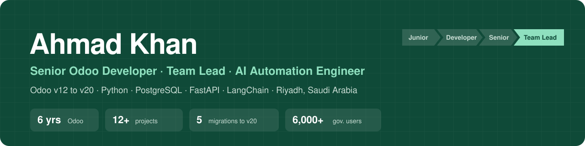

  
  
  
  

## About me

I'm a **Certified Odoo Functional Consultant** and Senior Odoo Developer in Riyadh. For 6 years I've taken Odoo projects from requirements and solution design to go-live, for government, healthcare, e-commerce, procurement and retail clients in Saudi Arabia, Malta, Pakistan and China. Today I lead an Odoo team and the company's AI work, building assistants that answer from live Odoo data while respecting each user's permissions.

- 🏛️ Leading Odoo delivery of the Ministry of Islamic Affairs' **E-Masajid** platform for **6,000+ users**
- 🔄 **5 migrations** of code and database, up to **Odoo 20**
- 🧾 **ZATCA e-invoicing**, SAP, Yaqeen, payment gateways and 15+ integrations
- 🤖 AI health reports of 10+ pages in under 2 minutes, saving carers **80%+** of writing time
- 🏆 **Successful E-Procurement Implementation Award**, FPCL

📂 **[Read the detailed case studies on my portfolio](https://ahmadkhanamir17.github.io/#work)**

## 🚀 Featured build: SupportIQ

**AI support agents, built without code.** My self-hosted platform for building AI customer-support agents from an admin panel: any model (OpenAI, Claude, Gemini, Ollama), hybrid RAG with sources, tools with approval guardrails for risky actions, human hand-off with AI summaries, customer memory, and a one-line website widget. It ships with an Odoo connector, MCP tool servers and 210 automated tests.

`FastAPI` `LangGraph` `LangChain` `PostgreSQL + pgvector` `Redis` `MCP` `Docker`

## Selected projects

| Project | Industry | What I delivered |
|---|---|---|
| [E-Masajid](https://discovery.moia.gov.sa) | Government | Mosque management for 6,000+ users, REST APIs, Yaqeen, role-based security |
| [Jazi](https://jazi.com/) | E-commerce | Multi-country warehousing, bulk QA for 1,000+ products, AWS queues |
| [All Life Sciences](https://www.alllifesciences.com/) | Healthcare | Recruitment, payroll, academy, AI CV screening and form auto-fill |
| [MyCare Malta](https://www.mycaremalta.com/) | Healthcare | Patient and B2B portals, AI health reports |
| [Kamar2](https://kamar2.com/) | Retail | Odoo 17 → 20 migration, WhatsApp AI sales assistant |
| [FPCL E-Procurement](https://eproc.fpcl.com/) | Procurement | Vendor portal, e-bidding, SAP integration, award winner |
| [Infiniarc](https://www.infiniarc.com/en) | Retail | Full ERP, POS, ZATCA e-invoicing, stock reservation engine |

## My apps on the Odoo App Store

| App | Odoo | What it does |
|---|:---:|---|
| [AI Smart Semantic Search](https://apps.odoo.com/apps/modules/19.0/ai_ecom_smart_search) | 19 | Finds products by meaning, in any language · [live demo](https://apps.erpoxa.com/find-products) |
| [AI Product Suggester](https://apps.odoo.com/apps/modules/19.0/ai_ecom_product_suggester) | 19 | AI cross-sell and up-sell suggestions; about 95% less manual work |
| [AI CV Parser & Recruiter Form](https://apps.odoo.com/apps/modules/19.0/ai_hr_recruitment_form) | 19 | AI CV parsing inside the recruitment form |
| [Automatic Plaid Synchronization](https://apps.odoo.com/apps/modules/17.0/plaid_integration) | 17 | Automatic bank statement import through Plaid |
| [Private Chat](https://apps.odoo.com/apps/modules/17.0/private_chat) · [Private Thread](https://apps.odoo.com/apps/modules/17.0/private_thread) | 17 | Chatter messages only selected users can see |
| [POS Product Restriction](https://apps.odoo.com/apps/modules/17.0/pos_pricelist_items_only) · [POS Invoice Reference](https://apps.odoo.com/apps/modules/17.0/pos_invoice_reference) | 17 | Price-list product filtering and order references for POS |
| [Open New Tab by Ctrl + Click](https://apps.odoo.com/apps/modules/18.0/open_new_tab_lk) | 18 | Open any record in a new browser tab |

## Tech stack

  
  
  
  
  
  
  
  
  
  
  
  

**AI:** Claude, ChatGPT, Gemini, Ollama, LangGraph, RAG, pgvector, semantic search 
**Integrations:** ZATCA, Yaqeen, SAP, Tabby, Tamara, Checkout.com, Payfort, WhatsApp Business API, Twilio, SMSA, Naqel

## Let's talk

Open to senior Odoo, techno-functional and AI integration roles. Iqama transferable, 1-month notice, open to relocation. 
📧 [ahmadkhanamir17@gmail.com](mailto:ahmadkhanamir17@gmail.com) · 💼 [LinkedIn](https://www.linkedin.com/in/ahmadkhanamir17) · 🌐 [Portfolio](https://ahmadkhanamir17.github.io)
